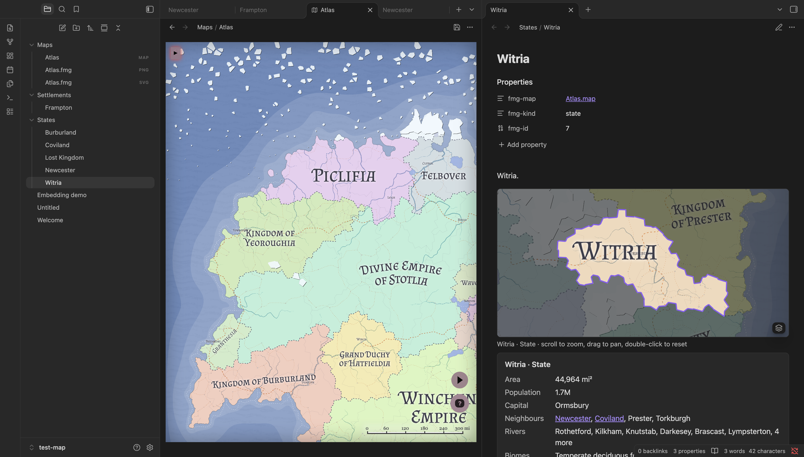
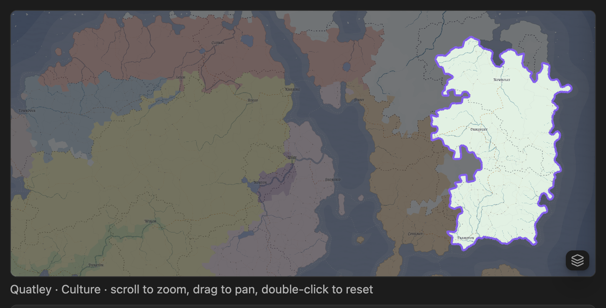
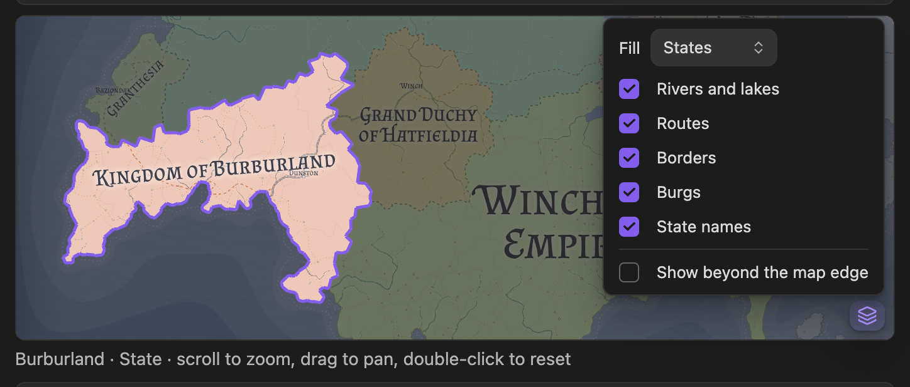
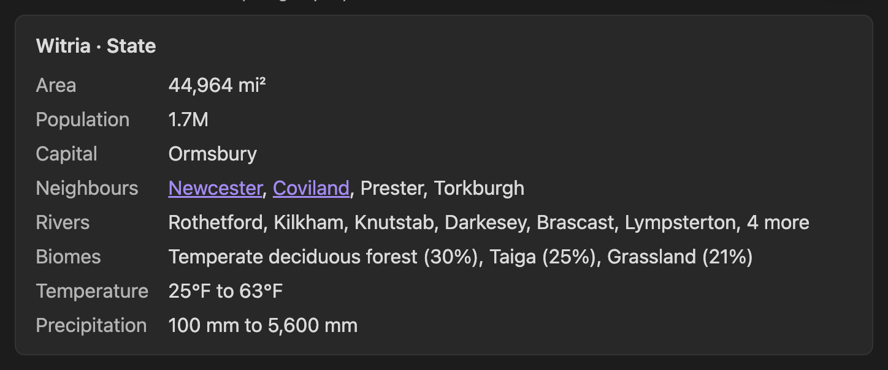
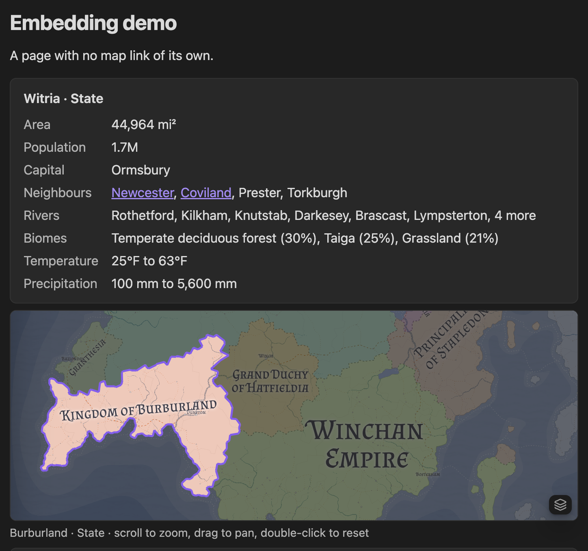

# Fantasy Map Generator for Obsidian

Edit [Azgaar's Fantasy Map Generator](https://github.com/Azgaar/fantasy-map-generator) (FMG) maps inside your vault, link your worldbuilding notes to the states, burgs and cultures on them, and show live mini-maps and facts anywhere in your notes.



## What it does

- **Maps are vault files.** A `.map` file opens in a bundled copy of FMG inside an Obsidian tab and saves back to the same file, so sync, git and backups cover your maps like any other note.
- **Notes stand for map entities.** Three plain properties link a note to a state, province, burg, culture, religion, marker or zone. Ctrl/Cmd+click a place on the map to open its note.
- **Live mini-maps.** An `fmg-map` block shows the entity cropped from the map, outlined, with everything else dimmed. It's sharp at any zoom, and you can fill areas by states, provinces, cultures or religions.
- **Live facts.** An `fmg-facts` block lists area, population, capital, neighbours, rivers, biomes and climate, in the map's own units, with neighbours linked to their notes.
- **Embed anywhere.** A session log or travelogue can show any country, whether or not it links to one.
- **Your notes stay yours.** The plugin never writes into a note's text. You decide where the blocks go, and folders are up to you.

## Install

The plugin isn't in the community catalogue yet, so you build it yourself. You need Node.js 26.5 or later and git, and the plugin runs on desktop Obsidian only.

```sh
git clone https://github.com/CatOfJupit3r/obsidian-fantasy-map-generator.git
cd obsidian-fantasy-map-generator
npm install
npm run build:release
```

Then copy the contents of `dist/` to `<your vault>/.obsidian/plugins/azgaar-fantasy-map-generator/` and turn on "Azgaar Fantasy Map Generator" under Settings → Community plugins.

## Quick start

1. Run **New map** from the command palette. It creates `Maps/Untitled map.map` and opens it in FMG.
2. Edit the map, then press **Ctrl/Cmd+S** inside FMG (or click the save icon). The map and its exports are written next to it.
3. Open or create a note for one of its countries and run **Link note to map entity**. Pick the state.
4. Add the blocks to the note:

   ````markdown
   ```fmg-map
   ```

   ```fmg-facts
   ```
   ````

5. Run **Map link report** to see which places on the map have no note yet, and create notes for them with one click.

## Linking notes to the map

A note stands for a map entity through three properties:

```yaml
---
fmg-map: "[[Atlas.map]]"
fmg-kind: state # state, province, burg, culture, religion, marker or zone
fmg-id: 7
---
```

- `fmg-map` is a real link. Obsidian shows it as one in the Properties view and updates it when you move or rename the map (with "Automatically update internal links" on).
- `fmg-id` is FMG's own id, so renaming the note or the entity in FMG keeps the link. Run **Link note to map entity** rather than looking the id up by hand.
- Linked notes can live in any folder. They're found by their properties, not their location.

Because they're ordinary properties, you can search and query them. In Obsidian's search:

```text
[fmg-kind:state]
```

With [Dataview](https://github.com/blacksmithgu/obsidian-dataview):

````markdown
```dataview
TABLE row["fmg-id"] AS "FMG id"
WHERE row["fmg-kind"] = "state"
SORT file.name
```
````

### Working between the map and notes

- **Ctrl/Cmd+click** on the FMG map opens the note of the most specific linked entity under the cursor: a burg or marker first, then a zone, province, state, culture and religion. A plain click still opens FMG's own editors.
- **Show on map** opens the active note's map in FMG and zooms to its entity.
- **Map link report** lists the map's entities with no note, each with a **Create note** button, and the linked notes that lead nowhere: to an entity removed in FMG, or to a map that is gone.

## Showing the map in notes

Both blocks work the same way. Left empty, they show the entity their own note links to. With options, they show any entity on any page.

### Mini-map: `fmg-map`

The map cropped to the entity, which is outlined while everything else is dimmed. Scroll to zoom, drag to pan, and double-click to reset. Clicking a neighbour that has a note opens it. The view stays on the map and never shows empty space past its edges.



The **layers button** in the bottom-right corner picks what areas are filled with (states, provinces, cultures, religions or nothing, in FMG's own colors) and which of FMG's layers to show. "Show beyond the map edge" lets the view leave the map. Your choices last while the note is open.



By default a mini-map fills areas of its own entity's kind: a culture note shows cultures, and a state note shows states. Burgs, markers and zones show states. Maps of provinces, cultures and religions start without state names, which would otherwise label the wrong areas.

### Facts: `fmg-facts`

What the map knows about the entity, in the map's own units. Neighbours that have notes are links.



Every entity also gets its terrain: rivers, dominant biomes, and the temperature and precipitation range. On top of that:

| Entity            | Facts                                                                     |
| ----------------- | ------------------------------------------------------------------------- |
| State             | Area, population, capital, neighbours                                     |
| Province          | Area, population, state, capital, neighbours                              |
| Burg              | Population, state (or the state it's the capital of), province, culture, religion, port, nearby burgs |
| Culture, religion | Area, population, neighbours                                              |
| Marker            | Type, state, province, nearest burg, nearby markers                       |
| Zone              | Type, area, population, the states it covers, neighbours                  |

### Embedding anywhere

Name the entity in the block to show it on a page that isn't linked to it:



````markdown
## Day 12: crossing into Witria

```fmg-map
note: "[[Witria]]"
height: 240
```

The border guards at Ormsbury asked for papers...

```fmg-facts
kind: burg
name: Ormsbury
```
````

The blocks accept these options:

| Option   | Example                | Meaning                                                                                            |
| -------- | ---------------------- | -------------------------------------------------------------------------------------------------- |
| `note`   | `note: "[[Witria]]"`   | Show the entity that note links to. Survives renaming the entity in FMG.                           |
| `kind`   | `kind: state`          | With `id` or `name`: show that entity directly.                                                   |
| `id`     | `id: 7`                | FMG's id for the entity. Survives renames.                                                         |
| `name`   | `name: Witria`         | The entity's name, ignoring case. Easy to read, but breaks if you rename it in FMG.                |
| `map`    | `map: "[[Atlas.map]]"` | Which map. Defaults to the note's linked map, or the vault's only map. Needed when you have several. |
| `height` | `height: 400`          | `fmg-map` only: height in pixels, 120 to 1200. 320 by default.                                    |

`map` and `note` take a link, quoted or not, or a plain path. You rarely need to type these: **Insert mini-map** and **Insert map facts** ask for a map and an entity, then insert a block at the cursor. The block names the entity by its note when it has one, otherwise by kind and id.

### A note template

With Obsidian's Templates core plugin or Templater, every new country note can start like this:

````markdown
---
fmg-map: "[[Atlas.map]]"
fmg-kind: state
fmg-id:
---

```fmg-map
```

```fmg-facts
```

## History

## Rulers
````

Fill in `fmg-id` with **Link note to map entity**, or let **Map link report** create the notes for you and paste the blocks in.

## Editing maps

- **Save** with the view's save icon, the **Save map** command, or Ctrl/Cmd+S inside FMG. This writes the `.map` file and refreshes its exports. FMG's own "Save to machine" isn't used.
- **Closing** a map with unsaved edits saves them. If the file changed on disk meanwhile (through sync or git, say), the edits go to `<name> (unsaved changes).map` next to it instead, and a notice tells you.
- **Conflicts:** saving over a file that changed on disk asks whether to reload or overwrite. A change on disk with no unsaved edits simply reloads the map.
- **New map** creates `Untitled map.map` (then `Untitled map 1.map`, ...) in the maps folder and saves the map FMG generates for it.
- FMG's autosave to browser storage and its "save to desktop" reminders are off: the vault file is where the map lives.

## Commands

| Command                    | What it does                                                                    |
| -------------------------- | ------------------------------------------------------------------------------- |
| New map                    | Creates a new `.map` in the maps folder and opens it                            |
| Save map                   | Saves the open map and refreshes its exports                                    |
| Link note to map entity    | Links the active note to an entity you pick                                     |
| Show on map                | Opens the note's map in FMG, zoomed to its entity                               |
| Map link report            | Lists entities with no note, with buttons to create them, and broken links      |
| Insert mini-map            | Inserts an `fmg-map` block for an entity you pick                               |
| Insert map facts           | Inserts an `fmg-facts` block for an entity you pick                             |

## Settings

- **Maps folder:** where **New map** creates files. `Maps` by default.
- **Exports on save:** which of the files below are written next to each map.
- **New note folders:** per kind, where **Create note** in the link report puts notes. Empty uses Obsidian's default location for new notes.
- **Fantasy Map Generator version:** the bundled FMG release (v1.154.2).

## Exports

Each save writes these next to the map, named after it with a `.fmg.` infix so they never clash with your own files. For `Maps/Atlas.map`:

| Setting         | File                             | Contents                                                                                         | Default |
| --------------- | -------------------------------- | ------------------------------------------------------------------------------------------------ | ------- |
| SVG render      | `Maps/Atlas.fmg.svg`             | FMG's "Export to SVG" of the whole map. Mini-maps draw from it, sharp at any zoom                | on      |
| PNG render      | `Maps/Atlas.fmg.png`             | The whole map at FMG's PNG resolution setting, without scale bar or vignette                     | on      |
| Full JSON       | `Maps/Atlas.fmg.json`            | FMG's "Export to JSON, Full". The blocks read every fact from it                                 | on      |
| Markers GeoJSON | `Maps/Atlas.fmg.markers.geojson` | FMG's "Export markers to GeoJSON": a `FeatureCollection` of `Point` features                     | on      |

Keep the Full JSON export on: the blocks, the link report and **Link note to map entity** all read it. Without the SVG export, mini-maps fall back to the PNG, which blurs when zoomed in and has its layers baked in.

The JSON is also handy for your own scripts. Burgs are under `pack.burgs` (`name`, `x`, `y`, `cell`, `state`, ...) and markers under `pack.markers` (also in the GeoJSON, with FMG's longitude and latitude as coordinates). `x` and `y` are map units on a map of `info.width` by `info.height`. Climate per grid cell is in `grid.cells[].temp` and `grid.cells[].prec`.

## Upgrading from 0.1

Version 0.1 linked notes with a nested `fmg: { map, kind, id }` property, wrote a `[!map-facts]` callout into each linked note on save, and baked a PNG thumbnail per entity (`Maps/Atlas.fmg.state-7.png`). On start, the plugin migrates such notes:

- the nested link becomes the `fmg-map`, `fmg-kind` and `fmg-id` properties,
- the callout is replaced in place by empty `fmg-map` and `fmg-facts` blocks (only `fmg-facts` if the note already has a mini-map),
- the thumbnails go to the trash.

Notes already in the current shape are left alone, and a notice says what was moved.

## Trust and network access

A `.map` file is more than data: FMG runs part of it as code (a map's goods definitions are evaluated with `new Function`), so a map can run code inside FMG's frame. **Open only maps you trust.**

FMG's page carries a Content-Security-Policy that limits where data can go. Everything loads from the plugin's own files, except the Google font hosts (`fonts.googleapis.com`, `fonts.gstatic.com`) that FMG's exports read. FMG's online features (AI assistant, translation, emblem service) are blocked, and FMG runs in its desktop mode with no service worker.

While the plugin is loaded, it serves the bundled FMG files from an HTTP server bound only to `127.0.0.1`. Obsidian blocks nested assets beneath a plugin's `app://` URL, so this loopback server supplies the frame's scripts, styles, fonts and images without accepting connections from your network. It stops when the plugin unloads. The plugin reuses the same port across restarts, because FMG keeps its own options (performance preset, layer presets and the like) in that origin's storage. If the port is taken, it picks a free one, and FMG starts once with its default options.

## Development

| Script                  | What it does                                                                                                   |
| ----------------------- | -------------------------------------------------------------------------------------------------------------- |
| `npm run build:fmg`     | Clones FMG at the tag pinned in `src/fmg/fmg-pin.ts` into `node_modules/.cache/obsidian-fmg/`, checks the commit and runs FMG's own build in desktop mode, with a minimal environment |
| `npm run build`         | Bundles the plugin and copies FMG from that cache into `dist/fmg/`, dropping FMG's service worker and injecting the bridge script and the Content-Security-Policy. It never touches the network |
| `npm run build:release` | `build:fmg`, then `build`. Fails when FMG is missing                                                           |
| `npm run check-types`   | Type checks the plugin, tests and scripts                                                                      |
| `npm test`              | Runs the Vitest suite against a small fake of the Obsidian API                                                 |

`dist/` holds `main.js`, `manifest.json`, `styles.css`, `LICENSE-FMG` and `fmg/`.

## Licence

The plugin is MIT-licensed (see `LICENSE`). FMG is MIT-licensed by Max Haniyeu (Azgaar), and its licence ships as `LICENSE-FMG`.
